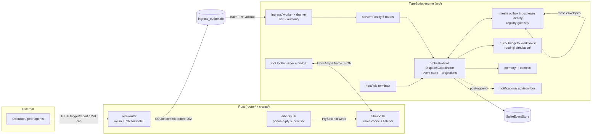

# Maintainability Audit — Phase 1: Architecture & Code

> **v2 note:** this report preserves the v1 evidence. Classification corrections and
> reconciled finding IDs live in `audit-changelog.md` (C1–C7) and `findings-register.md`
> (v2).

**Date:** 2026-10-19 · **Commit:** `6dc9b04` · Sources: `TsArchMap` + `RustContractsMap`
scouts (reviewed), lead-reviewer spot-verification. [Verified] = re-checked first-hand.

## 1. Architecture map

### 1.1 Runtime topology

Key facts (verified): router commits to SQLite before 202 and never authorizes
(admission ≠ authorization, `router/src/lib.rs:22-45`); the TS worker is the sole
authorization authority; the engine and router share a SQLite file, not a socket; the
IPC bus is a Unix socket with a 4-byte framing protocol duplicated in TS
(`src/ipc/publisher.ts`) and Rust (`crates/aibr-ipc`); `aibr-pty` and the Rust IPC
listener currently have **no production consumer** (TUI retired, Phase 6).

### 1.2 Module dependency direction (TS, 31 modules)

Declared layering (ADR 0001, ADR 0007 §1) with source-scan enforcement in
`tests/unit/*/barrel.test.ts` + `mesh/registry/no-scheduling-edges.test.ts` +
`server/route-boundary.test.ts`. Downward edges hold for the M6 modules
(`rules, workflows, budgets, routing, simulation, notifications` — `notifications`
imports nothing). `config/` is a dependency-free leaf. `orchestration/` owns canonical
contracts (`identifiers/schemas/types/digest/versioning/transitions`).

Measured violations / gaps (all [Verified] by import grep):

| # | Observation | Evidence |
|---|---|---|
| A1 | **memory ↔ orchestration cycle**: `orchestration/coordinator/coordinator.ts:34` + `coordinator/types.ts:15` import `memory/ports.js`; `orchestration/roundtable/memory.ts:27` deep-imports the **concrete** `memory/in-memory-repository.js` for `deriveMemoryId` while typing against `ports.js` | verified imports |
| A2 | **mesh ↔ orchestration cycle**: `mesh/fault/controller.ts:24-29` → coordinator/event-store/projections; `coordinator.ts:10` → `mesh/protocol/negotiation.js` | verified |
| A3 | **application ↔ orchestration cycle**: `application/service.ts` → orchestration; `orchestration/projections/tui-adapter.ts:8` → `application/types.js` | scout + import grep |
| A4 | **routing has a third undeclared edge**: `routing/types.ts:97` imports `mesh/protocol/identifiers.js` (`ARRAY_MAX`) while docs/tests claim "exactly two downward edges"; the barrel test's forbidden list omits `mesh/protocol` | verified |
| A5 | **rules edge widened by the enforcing test**: ADR 0007 names `rules → mesh/protocol/safe-pattern`; `rules/compile.ts:52`, `rules/limits.ts:52` also import `mesh/protocol/bounds.js`, and `barrel.test.ts:312` was widened to allow it | scout + import grep |
| A6 | **`orchestration/event-store/sqlite-driver.js` is a de-facto shared utility** deep-imported from `callback/`, `ingress/`, `storage/`, `upgrade/`, `mesh/fault/` — outside any declared layer | scout |

Interpretation: the layering rules are real and enforced, but enforcement has been
widened where convenient (A4/A5), and three module pairs are bidirectional (A1–A3).
The rules are enforced by ~8 copy-pasted source-scan barrel tests (see Phase 2 §6.3) —
the enforcement mechanism itself is a maintenance surface.

### 1.3 State ownership

Single-owner model is mostly clean (details in the scout record):
kernel event log (`SqliteEventStore`, written via `CommandLog.append` seam,
production writer `DispatchCoordinator` in `mesh/fault/controller.ts:325`); job records
(`JsonFileJobStore`); mesh outbox/inbox/lease/registry over one SQLite set (migrations in
`mesh/fault/durable.ts`); callback egress outbox; in-memory notifications (15-min
retention); terminal recovery store; in-memory aggregate repos (charter/roles/roundtable/
templates) owned by coordinator deps.

Gaps:
- **Budget ledger has no durable store in `src/`** — `BudgetLedger` is instantiated only
  by `simulation/plan.ts:1062` over an in-memory counting probe, though
  `budgets/recovery.ts` implements crash-recovery against a durable `BudgetLedgerStore`
  port that nothing constructs. [Scout inference; construction grep agrees — NEED EVIDENCE
  whether a durable store exists in a sibling repo]
- **Two config loaders**: `config/loader.ts:loadConfig` vs `host/profile-store.ts:readConfig`
  both parse `bridgeConfigSchema`.
- **Three "who can take work" surfaces**: `registry/` (`CapabilityRouter` +
  `ConfigAgentRegistry` — constructed **only** in `tests/unit/registry/router.test.ts`
  [Verified]), `mesh/registry/` (`MeshNodeRegistry`), `routing/` (`rankNodes`).
- **tasks vs jobs vs orchestration Task**: `tasks/` writes legacy `tasks.md`, `jobs/` is
  the legacy job store, orchestration `Task` is canonical; `ingress/runtime.ts` keeps all
  three alive.

## 2. Critical runtime flows (traced)

1. **Trigger admission → execution**: `POST /trigger` → router (`routes.rs`:
   constant-time bearer → Zod-shaped generated type with `deny_unknown_fields` →
   allowlist → SQLite admit → 202) → `aibr worker` (`ingress/worker.ts` claims row,
   re-validates `triggerRequestSchema`, source/project authorization, plan approval) →
   `monitorSession` (opencode SDK) → job JSON + `report` callback via egress outbox.
   Boundaries crossed: network → Rust → SQLite → TS → opencode HTTP → callbacks.
   Failure modes: 401/400/403/404/409/503 documented; job `timed_out` sweep at startup
   (`bridge.ts`); **root-cause errors swallowed in `opencode/monitor.ts`** (Phase 2 §5).
2. **Kernel command dispatch**: `server/routes/orchestration.ts` → `DispatchCoordinator`
   → authorization against the **recorded log** (not payload) → plan (18 per-command
   planners) → event append (transaction) → runtime effects **outside** the transaction →
   projections/reducer → SSE gateway (`mesh/gateway/events`) + notification consumer
   (post-append decorator in `bridge.ts:36-58`). Invariants G1–G3 (Phase 2 §4).
3. **Mesh relay**: `DurableEventOutbox` (SQLite) → `OutboxDeliverer` (backoff constants
   shared by name with router policy) → peer inbox → `MeshEventIngestor` → controller
   lease + epoch gate → coordinator. Fault suite proves exactly-once under 5
   retransmissions and restart persistence.
4. **Terminal WS**: `@fastify/websocket` route in `mesh/gateway/terminal/` — auth before
   upgrade, single input owner (F1 claim/release), revocation closes sockets;
   router deliberately lacks `ws` so it cannot 101 this path.
5. **IPC bus**: `aibr serve`/`worker` → `startIpcBus` (`ipc/bridge.ts`) →
   `IpcPublisher` binds `/tmp/aibr/aibrd.sock` (0700) → framed JSON snapshots/diffs;
   `EngineWorldSource` publishes `panes: []` and pane commands answer `not_allowed`
   because `aibr-pty` is not wired to a `PtySink` consumer.

## 3. Complexity hotspots (evidence-backed)

| File | Lines | Verdict | Class |
|---|---|---|---|
| `orchestration/coordinator/coordinator.ts` | 2,368 | **God class** `DispatchCoordinator`: 18 command planners + roundtable lifecycles + charter lifecycles + memory write-back subsystem + outbox acks. Largest method `#executeDispatch` ~260 lines. Highest churn (2,514 lines over 7 commits) in the repo's most invariant-dense module | SIMPLIFY |
| `rules/evaluate.ts` | 2,032 | Cohesive single evaluator ("NO SECOND EVALUATOR. EVER."); ~35 helpers, `evaluateRules` ~240 lines | KEEP (cohesion deliberate) |
| `orchestration/schemas.ts` | 1,559 | Canonical schema home per ADR 0001; permanent merge magnet but single-sourced | KEEP |
| `rules/compile.ts` / `preview.ts` / `types.ts` | 1,478/1,470/1,368 | Cohesive compiler pipeline + preview reusing the evaluator | KEEP |
| `memory/in-memory-repository.ts` | 1,358 | `MemoryRepositoryEngine` ~1,000-line class; single responsibility, oversized | SIMPLIFY |
| `simulation/plan.ts` + `types.ts` | 1,265+1,128 | Dry-run composer; well tested but a whole subsystem whose production consumer is the `aibr tui`/simulation path | NEED EVIDENCE (H5) |
| `cli/setup-step-widgets.ts` + `setup-wizard.ts` | 1,224+1,093 | Interactive onboarding UI; large but bounded and heavily tested | KEEP |
| `application/service.ts` | 1,223 | **Test-only** reference implementation (no production constructor [Verified via scout + grep]) | NEED EVIDENCE → REMOVE candidate |
| `terminal/herdr-terminal-backend.ts` | 1,182 | 3 classes per file (backend + 2 `HerdrClient` impls) | SIMPLIFY (file split only) |
| `cli.ts` | 1,175 | Arg parsing + dispatch + wiring; 17-commit churn hotspot; lazy imports keep boot cheap | SIMPLIFY (low priority) |

Churn × complexity intersection (the maintenance-economics hotspot): `coordinator.ts`
(2,368 lines / 7 touch commits), `cli.ts` (1,175 / 17), `orchestration/schemas.ts`
(1,559 / 6), `orchestration/invariants.ts` (761 / 7), `projections/reducer.ts`
(1,179 / 8).

## 4. Abstraction & indirection review (over-engineering framework)

**Healthy multi-impl ports (KEEP):** `TerminalBackend` (tmux + Herdr),
`AgentRuntimeAdapter` (opencode/codex/claude), `HerdrClient` (2), memory/SQLite store
pairs (`CommandInboxStore`, `NodeRegistryStore`, `ControllerLeaseStore`, `KeyStore`,
`EventOutboxStore`), `ProcessRunner`/`Prompter` (fake-able for tests).

**Single-impl seams (mostly test seams):** `JobStore→JsonFileJobStore`,
`MemoryStore→FileMemoryStore` (self-described "orphan" in `memory/migration.ts:11`
[Verified]), `TaskGraphSyncer→FileTaskGraphSyncer`, `PlanReviewProvider→
ConfigPlanReviewProvider`, `LocalApplicationService→InMemoryLocalApplicationService`,
`LocalProjectRegistry→ProfileLocalProjectRegistry`, `MemoryWorkflow→
RepositoryMemoryWorkflow`, `AgentRegistry→ConfigAgentRegistry`, `IpcWorldSource→
EngineWorldSource`, `IngressLifecycleObserver→QueueBridge`, `CommandEpochGate→
MeshCommandEpochGate`, `BudgetLedgerStore→InMemoryBudgetLedgerStore` (explicitly "the
seam a durable implementation would fill"), `RedactionPipeline→
DeterministicRedactionPipeline`.

Assessment (per plan §6): most single-impl seams cost one interface + one import and buy
testability of invariants (G1–G10) — **KEEP**. Exceptions where the seam masks a missing
capability rather than enabling testing: `BudgetLedgerStore` (durable impl missing while
recovery logic exists for it), `AgentRegistry`/`CapabilityRouter` (dead production
surface, tests-only [Verified]), `MemoryStore→FileMemoryStore` (self-declared orphan).
Classified in the findings register.

## 5. Phase 1 conclusions

1. The architecture is **deliberately documented and mostly enforced** (ADRs, source-scan
   tests, contract chain). Complexity is largely justified by invariants, not fashion.
2. The real maintenance costs: (a) `DispatchCoordinator` god class in the hottest module;
   (b) three bidirectional module pairs + one shared SQLite driver outside the layering;
   (c) test-only/orphan modules living beside production code (`application/service.ts`,
   `registry/`, `memory/store.ts`); (d) overlap in "who can take work" (3 surfaces) and
   "what is a task" (3 models).
3. Generated-artifact weight (124k-line `router/src/contracts.rs`) is a repo/review cost
   with a documented incident-driven rationale — decision deferred to Phase 4 (H3).
