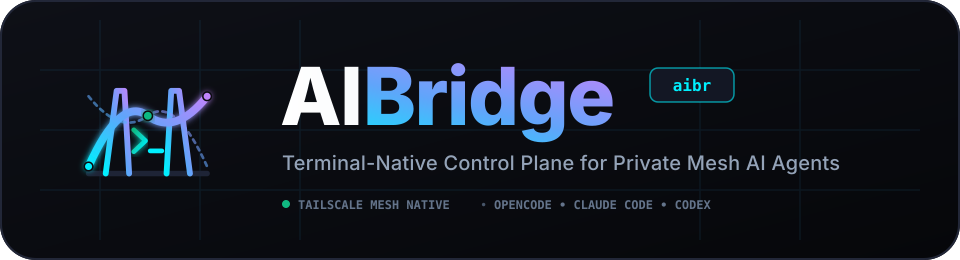

<h1>AIBridge</h1>

<p><strong>Tailscale mesh control plane for AI agents.</strong></p>

<p align="center">
  
</p>

<p align="center">
  <a href="Docs/assets/logos/logo-design-system.html"><code>╭─▲─╮ ◈ AIBridge</code></a>
</p>

[](https://github.com/nyugennguyen/AIBridge/actions/workflows/ci.yml)
[](https://www.npmjs.com/package/@nyugennguyen/aibridge)
[](LICENSE)
[](https://bun.sh)
[](https://www.rust-lang.org)

**AIBridge** is a resilient, polyglot orchestrator and agent mesh connecting OpenCode, Claude Code, and Codex execution daemons securely across machines over private Tailscale networks.

A typical setup: **Claude Code on your laptop is the orchestrator**. Through the AIBridge plugin it hands work (integration tests, bug reproduction, log reading, a fix on a branch) to worker nodes such as a staging VPS, then reads the findings and continues locally. Each worker runs the job with Claude Code or OpenCode, inside a capability profile it controls, pinned to an exact commit.

**New in 3.2.0:** a job API and CLI (`aibr jobs`, `aibr job`, `aibr cancel`, `aibr attach`), job reconcile and orphan-process cleanup after a restart, security hardening (plan self-approval, `GET /jobs/:id`, job ids, wider secret redaction), and about 45k lines of unwired code removed. Read **Removed** and **Upgrade notes** in the [CHANGELOG](CHANGELOG.md#320---2026-11-26) before upgrading.

**New in 3.1.1:** the unused TUI, Herdr, terminal and IPC layer is removed (about 54k lines, two Rust crates); `aibr tui`, `--ipc-publish` and `terminal.backend: "herdr"` were deprecated and are removed in 3.2.0 ([ADR 0014](Docs/adr/0014-claude-is-the-operator-interface.md), [CHANGELOG](CHANGELOG.md#311---2026-11-26)).

**New in 3.1.0:** Claude Code as a worker runtime and as the orchestrator (plugin + MCP server), signed requests and one-code pairing (`aibr enroll`), operator approval with an audit ledger, jobs pinned to `repo@sha`, and a quickstart (`aibr init`, `aibr doctor`, `aibr ping`, `aibr send`). See the [CHANGELOG](CHANGELOG.md#310---2026-11-26), and its **Behaviour changes** before upgrading a running node.

---

## Architecture Overview

By default the bridge (`aibr serve`) admits `/trigger` itself and runs each job on the worker's runtime:

```
   Orchestrator: Claude Code + AIBridge plugin, or `aibr send`
          │  POST /trigger over Tailscale (bearer token + ed25519 signature)
          ▼
   ┌──────────────────────────────────────────────────────────────┐
   │ aibr serve (Bun / TypeScript) on the worker's Tailscale IP   │
   │ • Authentication, pinned peer keys, replay protection        │
   │ • Source authorization & project allowlists                  │
   │ • Capability profile + frozen safety floor of deny rules     │
   │ • Operator approval for gated jobs (hash-chained ledger)     │
   │ • Job pinned to repo@sha, run in its own git worktree        │
   └───────────────┬──────────────────────────────┬───────────────┘
                   ▼                              ▼
     Claude Code (`claude -p`, per job)   OpenCode (127.0.0.1:4096)
                   │                              │
                   └──── POST /report to the orchestrator ────────┘
```

### Optional: Rust ingress router

For OpenCode workers that need a hardened, durable admission tier, `bridge.ingress_mode: "router"` (installer flag `--ingress router`) puts a native Rust router (`aibr-router`) in front of a Bun drain worker (`aibr worker`). Router mode admits on the bearer token only, so it does not support request signing or the Claude Code runtime.

```
                      Private Tailscale Network (100.64.0.0/10)
                                       │
                          HTTP/JSON POST /trigger
                                       ▼
             ┌─────────────────────────────────────────────────┐
             │       Tier 1: aibr-router (Native Rust)         │
             │─────────────────────────────────────────────────│
             │ • Binds bridge.host:bridge.port (preflight)     │
             │ • Constant-time Bearer authentication (subtle)  │
             │ • Bounded inflight concurrency (cap: 64)        │
             │ • Payload body limit (1 MiB ceiling)            │
             │ • Structural validation & envelope checks       │
             └───────────────────────┬─────────────────────────┘
                                     │ Commit before 202 (SF-08)
                                     ▼
                      ┌──────────────────────────────┐
                      │    Durable SQLite Queue      │
                      │  (ingress_outbox, WAL mode)  │
                      └──────────────┬───────────────┘
                                     │ Drain via claim lease
                                     ▼
             ┌─────────────────────────────────────────────────┐
             │       Tier 2: aibr worker (Bun / TypeScript)    │
             │─────────────────────────────────────────────────│
             │ • Sole semantic authorization authority         │
             │ • Source authorization & project allowlists     │
             │ • Plan review & safety policy enforcement       │
             │ • Per-job repo@sha worktree & result sanitizer  │
             │ • Durable egress callback outbox                │
             └───────────────────────┬─────────────────────────┘
                                     │ Loopback only (127.0.0.1:4096)
                                     ▼
             ┌─────────────────────────────────────────────────┐
             │            Local OpenCode Instance              │
             └─────────────────────────────────────────────────┘
```

### Not yet wired

Roughly 11,000 of the 50,000 lines in `src/` cannot be reached from the `aibr` and bridge entry points; `bun run docs:reachability` measures it. Almost all of it is code kept for the roadmap with deadlines (the rest is under 100 lines: `src/mesh/identity/memory-key-store.ts` and the `src/diagnostics/index.ts` barrel) ([ADR 0016](Docs/adr/0016-keep-selected-unwired-code-with-deadlines.md)). The rest of the unwired code was removed in 3.2.0: rules, budgets, workflows, simulation, routing, registry, sdk, upgrade, the dead part of the mesh (leases, gateway, inbox, outbox transport) and the orchestration kernel (coordinator, scheduler, projections, charter and roundtable runtime, the `/orchestration/*` routes). What remains of `src/mesh` is node identity and request signing, the wire ids and replay window, and the delivery backoff policy; what remains of `src/orchestration` outside the event store is the schemas, identifiers and digests the runtime, pairing and request signing use.

| Path | Serves | Wire by | Delete by |
|---|---|---|---|
| `src/memory` | Handoff summaries, project memory | 3.3.0 | 3.4.0 |
| `src/orchestration/event-store` | Durable job event log | 3.3.0 | 3.4.0 |
| `src/runtime/codex-adapter.ts`, `src/runtime/discovery.ts` | Codex runtime | 3.3.0 | 3.4.0 |
| `src/context` | Context snapshot attached to a job | 3.4.0 | 3.5.0 |
| `src/notifications` | Discord and Telegram notifications | 3.5.0 | 3.6.0 |

### Core Design Invariants

1. **Two-Tier Validation:** The router is a structural gate, never an authorization authority. The worker independently re-parses and enforces all semantic permissions, allowlists, and approvals.
2. **Commit Before 202 (`SF-08`):** An admission response (`HTTP 202 Accepted`) is emitted **only** after work has been durably committed to SQLite disk storage (`synchronous=FULL`). No in-memory queues or fallback drop-paths exist.
3. **Decoupled Interface:** Claude Code with the AIBridge plugin dispatches and follows work; human-only actions (approve, reject, kill switch) stay in the `aibr` CLI on the worker. Closing the interface never disrupts running background agents.
4. **Append-Only Evidence:** The operator approval ledger is hash-chained and append-only, and terminal outbox rows are kept. Nothing in AIBridge rewrites or deletes that history.
5. **Terminal Outbox Rows are Evidence:** Errored or failed outbox records are preserved as permanent audit evidence with error taxonomy codes and attempt counters.
6. **Automated Secret Redaction:** Prompts, transcripts, raw memory, bearer tokens, and private paths are scrubbed by default across all logs, telemetry, and diagnostics bundles.

---

## Supported Platforms & Requirements

AIBridge is tested and supported on:
- **macOS** (Apple Silicon `aarch64` and Intel `x86_64`)
- **Debian / Ubuntu** Linux (`x86_64` and `aarch64`)

Ensure each participating machine has:
- [Bun](https://bun.sh) `>= 1.3.0` (install from bun.sh)
- [tmux](https://github.com/tmux/tmux) `>= 3.0` is optional: only `aibr start --foreground` uses it (the default is a launchd/systemd user service). `aibr verify` and `aibr doctor` warn, not fail, when it is missing
- An agent runtime on workers: [OpenCode](https://opencode.ai) bound strictly to loopback `127.0.0.1:4096` (`bun install -g opencode-ai`) or [Claude Code](https://claude.com/claude-code) 2.1.x or newer, logged in (`claude` once, or `CLAUDE_CODE_OAUTH_TOKEN` / `ANTHROPIC_API_KEY`). An orchestrator-only machine needs Claude Code but not OpenCode.
- [Tailscale](https://tailscale.com) installed, logged in, and authenticated (bridge binds to private Tailscale IPv4, never public Internet)

---

## Quick Start

### 1. Install

One-liner automated installer (macOS, Debian, Ubuntu):

```bash
curl -fsSL https://raw.githubusercontent.com/nyugennguyen/AIBridge/main/scripts/install.sh | bash
# non-interactive (CI):
curl -fsSL https://raw.githubusercontent.com/nyugennguyen/AIBridge/main/scripts/install.sh | bash -s -- --yes
# pick a role and runtime (defaults: --role worker --runtime auto):
curl -fsSL https://raw.githubusercontent.com/nyugennguyen/AIBridge/main/scripts/install.sh | bash -s -- --role orchestrator
```

Prompts are read from your terminal (`/dev/tty`), so the one-liner works when piped; without a terminal, pass `--yes`. Flags: `--role worker|orchestrator|both`, `--runtime opencode|claude|auto`, `--with-claude-plugin`, `--ingress router`, `--with-units` (needs a repository checkout). The installer offers to install Tailscale, never installs OpenCode or Claude Code (it prints the install command), and only prints a note (no prompt) when tmux is absent on a worker, and offers to add Bun's bin directory to your shell `PATH`.

Manual fallback via Bun:

```bash
bun install -g @nyugennguyen/aibridge
aibr --version
```

If `aibr` is not found, verify that the global Bun bin directory `$(bun pm bin -g)` is on your `PATH`.

### 2. Set up the machine (`aibr init`)

```bash
aibr init
```

At most four questions:

1. **Role** — `worker` (runs jobs here), `orchestrator` (Claude Code dispatches work from here), or `both`.
2. **Runtime** — `opencode` or `claude`, detected on `PATH`; asked only when both or neither is installed.
3. **Project directory** (workers) — defaults to the git root of the current directory. `$HOME`, `/` and any parent of `$HOME` are refused.
4. **Network** — press Enter to create a new one (this machine prints a one-time pairing code), or paste the code another machine printed to join it.

Everything else has a safe default and is never shown: the bearer token and OpenCode password are generated (`0600` files under `~/.local/share/aibridge/<profile>/secrets/`), new profiles require ed25519-signed requests, the bridge listens on the Tailscale IP, port `8787`. A worker's bridge is then started as a user service (see step 3 below). Every answer has a flag (`aibr init --help`), so `aibr init --role worker --runtime claude --project ~/src/app --new` asks nothing.

A typical two-machine setup:

```bash
# on the worker (e.g. a staging VPS): prints a pairing code
aibr init --role worker
# on your laptop: paste that code when asked
aibr init --role orchestrator
```

Pairing pins both machines' keys, writes `agents[]` / `allowed_sources[]` on both sides, and hands the worker's bearer token over without anyone copying it. To pair more machines later: `aibr enroll issue` on the worker, `aibr enroll join <code>` on the other node ([pairing guide](Docs/guides/pairing.md)).

`aibr setup --profile <name>` is still the full wizard (re-run it to change a profile; `--advanced` adds the ports and `--config` a different config path).

### 3. Check it end to end (`aibr doctor`)

```bash
aibr doctor
```

One ✓/✗ list: the role's prerequisites, Tailscale, the config, the project, the secrets, tailnet discovery, whether the bridge runs and answers `/health`, and finally a **ping** of every peer this machine calls — a signed no-op job that the peer authenticates, completes and reports back. Every ✗ line comes with the exact command that fixes it.

### Running the bridge (`aibr start` / `aibr stop` / `aibr logs`)

`aibr init` already started it on a worker. To manage it yourself:

```bash
aibr start --profile <name>     # install + load the user service, wait for /health
aibr stop --profile <name>      # unload and remove it
aibr status --profile <name>    # what runs it (launchd / systemd / tmux) and /health
aibr logs --profile <name> -f   # <state dir>/logs/aibridge.log
```

The user service is a launchd agent on macOS (`~/Library/LaunchAgents/com.aibridge.<name>.plist`, loaded with `launchctl bootstrap gui/$(id -u)`) and a systemd user unit on Linux (`aibridge-<name>.service`). It runs `aibr serve --profile <name>` (plus `opencode serve` on `127.0.0.1` for an OpenCode worker), restarts it on failure and at login, and writes stdout/stderr to the profile's log file. On a Linux server, run `sudo loginctl enable-linger $USER` so the service keeps running after you log out (`aibr doctor` tells you when this is needed).

For development, `aibr start --profile <name> --foreground` runs the same thing in the tmux session `aibridge-<name>` instead (`tmux attach -t aibridge-<name>`; windows stay open when a process exits). Use one or the other — they listen on the same port; `aibr stop` stops both.

### 4. Ping a peer and send the first job

```bash
aibr ping staging-vps
aibr send staging-vps "Run the tests and report failures." --capability run-tests
```

`aibr ping` is the proof that two machines work together: it reports the round trip, whether the worker's `/report` reached this machine, and what the peer accepts (capabilities and allowlisted project directories). `aibr send` fills in `source_agent_id`, `target_agent_id`, `callback_url`, `job_id` and the request signature; `--capability` defaults to the peer's read-only `investigate`, and `--project` to the peer's only project (or the one named like your current repository). It waits for the result and prints the summary and findings (`--no-wait` to return after dispatch). From Claude Code, the AIBridge plugin does the same (see below).

---

## Claude Code

### As the orchestrator (plugin)

```bash
aibr plugin install claude      # or: install.sh --role orchestrator --with-claude-plugin
aibr plugin status claude
```

This registers the plugin bundled in the npm package through the official `claude plugin` CLI; it never edits `~/.claude` files. In Claude Code you then get:

- MCP tools `bridge_peers`, `bridge_dispatch`, `bridge_status`, `bridge_await`, `bridge_result`, `bridge_events` and `bridge_cancel` (cancels only jobs this node dispatched; needs signed requests). There is deliberately no approve tool: approval stays with the operator.
- The `aibridge-dispatch` skill, which pushes the branch, dispatches with the commit sha, waits and reads the findings.
- `/aibridge:bridge-send <peer> <capability> <task>` and `/aibridge:bridge-status`.
- A short summary of peers and running jobs at session start.

Ask Claude something like *"run the integration tests on staging-vps for this branch and fix what fails"*. Details: [Claude Code as Orchestrator](Docs/guides/claude-code-orchestrator.md).

### As a worker runtime

With `runtime.kind: "claude"` (chosen by `aibr init` when Claude Code is installed), each job runs `claude -p` under a **capability profile** from the worker's own `capability_profiles`: allowed and denied tools, budget, turns, timeout, model and extra instructions. Workers set up by the wizard get a read-only `investigate` profile and a test-only `run-tests` profile. The caller only names the profile; an unknown name gets `403 unknown_capability_profile`.

Every launch also carries a frozen **safety floor** of deny rules (secrets, SSH and cloud credentials, AIBridge state, `curl`/`wget`/`ssh`/`sudo`) that no profile can remove. A job may name a configured repository and ref (`repo` + `ref`): the ref is resolved to a sha on acceptance and the job runs in its own detached git worktree, so the result belongs to an exact commit. `limits.max_concurrent_jobs` (default 2) caps parallel jobs. A step-by-step dev → staging walkthrough is in the [runbook](Docs/runbooks/claude-dev-staging.md).

---

## Operational Procedures

### Manual Bearer Tokens (Without Pairing)

Pairing (`aibr init` / `aibr enroll`) hands the bearer token over for you. If you instead share a token by hand (`aibr setup`, answer `P` to paste), generate a secure 32-byte hexadecimal random token:

```bash
openssl rand -hex 32
```

Both machines must use the same token. The token is not stored in `config.json` — it is kept separately at `~/.local/share/aibridge/<profile>/secrets/bearer_token` with `0600` permissions (owner-only) beneath your configured XDG data directory. Secrets you type or paste are not echoed to the terminal.

To check that two hosts share the token without putting it in shell history:

```bash
read -rs AIBRIDGE_TOKEN
printf '\n'
curl -i -X POST http://test-vps.tailnet:8787/trigger \
  -H "Authorization: Bearer $AIBRIDGE_TOKEN" \
  -H 'Content-Type: application/json' \
  -d '{}'
unset AIBRIDGE_TOKEN
```

An `HTTP 400` response means authentication succeeded and AIBridge rejected only the intentionally incomplete request body. An `HTTP 401` response means the token is missing or does not exactly match the token saved on the peer (or, with `"code": "signature_required"`, that the peer requires signed requests from a paired node — `aibr ping` from a paired node is the complete check).

### Troubleshoot Bearer-Token Authentication

| Symptom | Cause | Fix |
|---|---|---|
| `aibr ping` fails with `401` and mentions signing or pairing | This node is not paired with the peer (the peer requires signed requests). | `aibr enroll issue` on the peer, then `aibr enroll join <code>` here. |
| `HTTP 401` from `/trigger` or `/report` | The supplied token is missing or differs from the peer's token. | Pair again (`aibr enroll`), which hands the token over; or compare the token saved for the profile on both machines. |
| `bearer_token` file is missing | Setup did not complete for the selected profile, or profile data was removed. | `aibr doctor` names the fix; usually `aibr setup --profile <name>`. |
| `aibr status` is healthy but jobs fail | `/health` does not require authentication. | `aibr ping <peer>` (or `aibr doctor`) sends a real signed job and says where it fails. |

### Rotate a Bearer Token

The bearer-token secret is write-once from setup's point of view: re-running `aibr setup` keeps it unless you explicitly answer `G` (generate new) or `P` (paste) at the bearer-token prompt, which replaces it. To rotate a token:

1. Stop AIBridge on both machines (`aibr stop --profile <profile>`).
2. Remove `~/.local/share/aibridge/<profile>/secrets/bearer_token` (or the equivalent path beneath your configured XDG data directory) on both machines — or answer `G` on one machine and `P` on the other in the next step.
3. Run `aibr setup --profile <name>` again on both machines with one new shared token.
4. Restart both profiles (`aibr start --profile <profile>`) and check with `aibr doctor`.

### Approve Held Jobs (Operator)

A job is approval-gated when its capability profile has `"requires_approval": true` or the capability is listed in `planning.require_approval_for`; the worker decides from its own config, never from the caller's metadata. A gated job waits as `awaiting_approval`, with its ref already resolved to a sha, so you approve an exact commit. Only the operator can release them, on the worker itself, with the **operator token** (`AIBRIDGE_OPERATOR_TOKEN` or `<data>/aibridge/<profile>/secrets/operator_token`). A peer's bearer token gets 403, so a peer can never approve its own work.

```bash
aibr jobs pending --profile staging          # what is waiting
aibr approve <job_id> --profile staging      # shows capability, source, repo@sha, prompt; asks first
aibr reject <job_id> --reason "..." --profile staging
aibr stop --all-jobs --profile staging       # kill switch: stop every running job
```

Every decision is appended to a hash-chained `approvals.jsonl` ledger (ADR 0013). Creating the token is covered in the [runbook](Docs/runbooks/claude-dev-staging.md#create-the-operator-token).

### Update & Uninstall

To update AIBridge globally:

```bash
bun install -g @nyugennguyen/aibridge
```

To remove the AIBridge application binary (retaining your configuration, profiles, and state):

```bash
bun remove -g @nyugennguyen/aibridge
```

> [!WARNING]
> Removing the global package preserves your profiles, configuration, bearer tokens, and SQLite event logs. If you need to decommission a specific profile or perform a complete, destructive data cleanup, see the [Uninstallation & Profile Cleanup Guide](Docs/operations/deployment.md#uninstallation--profile-cleanup).

---

## CLI Overview

| Command | Description | Profile Required |
|---|---|:---:|
| `aibr init` | Quickstart: set up this machine in at most four questions. | Optional |
| `aibr doctor` | Checks the node end to end (verify + status + ping), with a fix per problem. | Optional |
| `aibr ping` | Sends a signed no-op job to a peer and waits for its result. | Optional |
| `aibr send` | Dispatches a job to a peer and waits for its result. | Optional |
| `aibr logs` | Prints (or follows, `-f`) the profile's bridge log. | Optional |
| `aibr setup` | Full interactive setup wizard; re-run to update a profile. | Optional |
| `aibr start` | Starts the bridge as a user service (launchd/systemd); `--foreground` runs it in tmux. | **Yes** |
| `aibr stop` | Stops the profile's service and tmux session (or every job with `--all-jobs`). | **Yes** |
| `aibr serve` | Runs bridge HTTP server directly in foreground. | **Yes** |
| `aibr worker` | Starts Tier 2 ingress drain worker. | **Yes** |
| `aibr status` | Reports what runs the bridge and probes `/health`. | **Yes** |
| `aibr verify` | Validates the role's dependencies, Tailscale, bearer token, and schema. | Optional |
| `aibr enroll` | Pairs nodes with one-time codes (issue, join, list, revoke). | Optional |
| `aibr approve` / `aibr reject` | Decides a job held for operator approval (on the worker). | Optional |
| `aibr jobs pending` | Lists jobs awaiting operator approval. | Optional |
| `aibr jobs` | Lists this node's jobs (`--all-nodes`: ask every peer with signed requests; `--watch`; `--status`, `--limit`, `--json`). | Optional |
| `aibr job <id>` | Shows one job; `--events` prints what it did, `-f` follows it until it ends. | Optional |
| `aibr cancel <id>` | Cancels one job (asks first; `--yes`). Not `aibr stop`, which stops the service or every job. | Optional |
| `aibr attach <id>` | Read-only `aibr job <id> --events -f`; attaches no terminal. | Optional |
| `aibr plugin` | Installs, removes or reports the Claude Code plugin (`install\|uninstall\|status claude`). | No |
| `aibr mcp` | MCP server used by the Claude Code plugin (`serve`, `summary`). | Optional |
| `aibr update` | Checks for and installs latest version. | Optional |
| `aibr bundle` | Generates a redacted diagnostic support bundle. | **Yes** |
| `aibr discover` | Lists tailnet peers and probes each peer's `/health`. | Optional |

For full command syntax and options generated from `aibr --help`, see [`Docs/reference/cli-reference.md`](Docs/reference/cli-reference.md).

---

## Documentation

Comprehensive documentation is organized around clear user needs in [`Docs/`](Docs/README.md):

- [**Documentation Index**](Docs/README.md) — Documentation map and navigation hub.
- [**Getting Started**](Docs/getting-started.md) — Step-by-step installation, profile setup, and first task dispatch.
- [**Current Architecture**](Docs/architecture/current-state.md) — Authoritative guide to components, trust boundaries, and persistence.
- [**Architecture Decisions (ADRs)**](Docs/adr/README.md) — Index of all 16 architectural decision records.
- [**Claude Code as Orchestrator**](Docs/guides/claude-code-orchestrator.md) — Installing and using the AIBridge Claude Code plugin.
- [**Pairing Guide**](Docs/guides/pairing.md) — Signed requests and `aibr enroll`.
- [**Claude Dev → Staging Runbook**](Docs/runbooks/claude-dev-staging.md) — End-to-end setup of a Claude Code orchestrator and a staging worker.
- [**Configuration Guide**](Docs/guides/configuration.md) — Complete `config.json` schema, XDG directories, and token rotation.
- [**Developer Guide**](Docs/guides/development.md) — Local development, test suites, contract parity, and release gates.
- [**Integrations Guide**](Docs/guides/integrations.md) — OpenCode, Claude Code, Codex, and Tailscale mesh.
- [**Deployment & Operations**](Docs/operations/deployment.md) — Headless tmux, macOS launchd, Linux systemd, and multi-node federation.
- [**Monitoring & Diagnostics**](Docs/operations/monitoring.md) — Health checks, diagnostic bundles, and queue monitoring.
- [**Operational Troubleshooting**](Docs/operations/troubleshooting.md) — Executable triage ladder, HTTP status codes, and recovery.
- [**Security Model**](Docs/security/security-model.md) — Inviolable safety floors, commit-before-202, and secret redaction.
- [**CLI Reference**](Docs/reference/cli-reference.md) — Generated command-line options and syntax.
- [**Historical Archive**](Docs/archive/README.md) — Preserved historical plans, brainstorms, and superseded designs.

---

## Contributing

See [**CONTRIBUTING.md**](CONTRIBUTING.md) for contribution guidelines, documentation governance lifecycle, coding standards, and verification gates.

---

## License

MIT License. See [LICENSE](LICENSE) for details.
