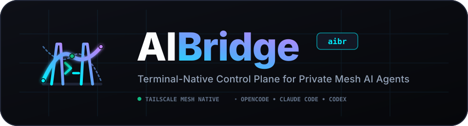

<h1>AIBridge</h1>

<p><strong>Tailscale mesh control plane for AI agents.</strong></p>

<p align="center">
  
</p>

<p align="center">
  <a href="Docs/assets/logos/logo-design-system.html"><code>╭─▲─╮ ◈ AIBridge</code></a>
</p>

[](https://github.com/nyugennguyen/AIBridge/actions/workflows/ci.yml)
[](LICENSE)
[](https://bun.sh)
[](https://www.rust-lang.org)

**AIBridge** is a resilient, polyglot orchestrator and agent mesh connecting OpenCode, Claude Code, and Codex execution daemons securely across machines over private Tailscale networks.

AIBridge replaces traditional monolithic bridge architectures with a **two-tier polyglot architecture**: a native Rust ingress router (`aibr-router`) for low-overhead, fail-closed admission and durable queuing, paired with a TypeScript/Bun worker daemon (`aibr worker`) for semantic task execution, rule evaluation, and distributed orchestration.

---

## Architecture Overview

```
                      Private Tailscale Network (100.64.0.0/10)
                                       │
                          HTTP/JSON POST /trigger
                                       ▼
             ┌─────────────────────────────────────────────────┐
             │       Tier 1: aibr-router (Native Rust)         │
             │─────────────────────────────────────────────────│
             │ • Binds bridge.host:bridge.port (preflight)     │
             │ • Constant-time Bearer authentication (subtle)  │
             │ • Bounded inflight concurrency (cap: 64)        │
             │ • Payload body limit (1 MiB ceiling)            │
             │ • Structural validation & envelope checks       │
             └───────────────────────┬─────────────────────────┘
                                     │ Commit before 202 (SF-08)
                                     ▼
                      ┌──────────────────────────────┐
                      │    Durable SQLite Queue      │
                      │  (ingress_outbox, WAL mode)  │
                      └──────────────┬───────────────┘
                                     │ Drain via claim lease
                                     ▼
             ┌─────────────────────────────────────────────────┐
             │       Tier 2: aibr worker (Bun / TypeScript)    │
             │─────────────────────────────────────────────────│
             │ • Sole semantic authorization authority         │
             │ • Source authorization & project allowlists     │
             │ • Plan review & safety policy enforcement       │
             │ • Reusable workflows & deterministic rules      │
             │ • Multi-project memory & secret redaction       │
             │ • Durable egress callback outbox                │
             └───────────────────────┬─────────────────────────┘
                                     │ Loopback only (127.0.0.1:4096)
                                     ▼
             ┌─────────────────────────────────────────────────┐
             │            Local OpenCode Instance              │
             └─────────────────────────────────────────────────┘
```

### Core Design Invariants

1. **Two-Tier Validation:** The router is a structural gate, never an authorization authority. The worker independently re-parses and enforces all semantic permissions, allowlists, and approvals.
2. **Commit Before 202 (`SF-08`):** An admission response (`HTTP 202 Accepted`) is emitted **only** after work has been durably committed to SQLite disk storage (`synchronous=FULL`). No in-memory queues or fallback drop-paths exist.
3. **Decoupled Interactive Interface:** Presentation is delegated to Herdr. Closing or disconnecting the interface never disrupts running background agents.
4. **Append-Only Immutability:** Authoritative event logs are immutable. Repair and maintenance tools never rewrite or delete history.
5. **Terminal Outbox Rows are Evidence:** Errored or failed outbox records are preserved as permanent audit evidence with error taxonomy codes and attempt counters.
6. **Automated Secret Redaction:** Prompts, transcripts, raw memory, bearer tokens, and private paths are scrubbed by default across all logs, telemetry, and diagnostics bundles.

---

## Supported Platforms & Requirements

AIBridge is tested and supported on:
- **macOS** (Apple Silicon `aarch64` and Intel `x86_64`)
- **Debian / Ubuntu** Linux (`x86_64` and `aarch64`)

Ensure each participating machine has:
- [Bun](https://bun.sh) `>= 1.3.0` (install from bun.sh)
- [tmux](https://github.com/tmux/tmux) `>= 3.0` for headless process supervision
- [OpenCode](https://opencode.ai) bound strictly to loopback `127.0.0.1:4096` (`bun install -g opencode-ai`)
- [Tailscale](https://tailscale.com) installed, logged in, and authenticated (bridge binds to private Tailscale IPv4, never public Internet)

---

## Quick Start

### 1. Install

One-liner automated installer (macOS, Debian, Ubuntu):

```bash
curl -fsSL https://raw.githubusercontent.com/nyugennguyen/AIBridge/main/scripts/install.sh | bash
# non-interactive (CI):
curl -fsSL https://raw.githubusercontent.com/nyugennguyen/AIBridge/main/scripts/install.sh | bash -s -- --yes
```

Manual fallback via Bun:

```bash
bun install -g @nyugennguyen/aibridge
aibr --version
```

If `aibr` is not found, verify that the global Bun bin directory `$(bun pm bin -g)` is on your `PATH`.

### 2. Setup Profile (`aibr setup`)

Run the interactive 5-step onboarding wizard:

```bash
aibr setup --profile <name>
```

For a two-machine setup, run on machine A (`aibr setup --profile dev-main`) and machine B (`aibr setup --profile test-vps`).

If you generate a token yourself, use a secure 32-byte hexadecimal random token:

```bash
openssl rand -hex 32
```

Both machines must use the same token. The token is not stored in `config.json` — it is kept separately at `~/.local/share/aibridge/<profile>/secrets/bearer_token` with `0600` permissions (owner-only) beneath your configured XDG data directory. Profile state lives in `~/.local/state/aibridge/<profile>/` with `0700` permissions.

### 3. Start Services (`aibr start`)

Start OpenCode and the AIBridge daemon in a managed tmux session:

```bash
aibr start --profile <name>
```

This creates a tmux session named `aibridge-<profile>` with two windows:
- `opencode` — running `opencode serve --port 4096 --hostname 127.0.0.1` (loopback only)
- `aibridge` — running the bridge daemon bound to your Tailscale IPv4 address on port 8787

Check health status:

```bash
aibr status --profile <name>
```

Attach to session: `tmux attach -t aibridge-<name>` (detach with `Ctrl+B, D`).

### 4. Verify Cross-Host Authentication

To verify that two hosts share the same token without putting credentials in shell history:

```bash
read -rs AIBRIDGE_TOKEN
printf '\n'
curl -i -X POST http://test-vps.tailnet:8787/trigger \
  -H "Authorization: Bearer $AIBRIDGE_TOKEN" \
  -H 'Content-Type: application/json' \
  -d '{}'
unset AIBRIDGE_TOKEN
```

An `HTTP 400` response means authentication succeeded and AIBridge rejected only the intentionally incomplete request body. An `HTTP 401` response means the token is missing or does not exactly match the token saved on the peer.

### 5. Trigger a Task

Dispatch a task across machines:

```bash
curl -X POST http://test-vps.tailnet:8787/trigger \
  -H "Authorization: Bearer $AIBRIDGE_TOKEN" \
  -H 'Content-Type: application/json' \
  -d '{
    "job_id": "job-001",
    "source_agent_id": "dev-main",
    "target_agent_id": "test-vps",
    "capability": "testing",
    "project_dir": "/srv/apps/app-under-test",
    "prompt": "Run tests and report failures.",
    "callback_url": "http://dev-main.tailnet:8787/report",
    "timeout_seconds": 1800
  }'
```

---

## Operational Procedures

### Troubleshoot Bearer-Token Authentication

| Symptom | Cause | Fix |
|---|---|---|
| `HTTP 401` from `/trigger` or `/report` | The supplied token is missing or differs from the peer's token. | Compare the token saved for the selected profile on both machines and enter the exact same value during setup. |
| `bearer_token` file is missing | Setup did not complete for the selected profile, or profile data was removed. | Run `aibr setup --profile <name>` again and provide the shared token. |
| `aibr status` is healthy but requests return `HTTP 401` | Health endpoint does not require authentication. | Verify tokens using the cross-host curl test above. |

### Rotate a Bearer Token

The bearer-token secret is write-once. To rotate a token:

1. Stop AIBridge on both machines (`tmux kill-session -t aibridge-<profile>`).
2. Remove `~/.local/share/aibridge/<profile>/secrets/bearer_token` (or the equivalent path beneath your configured XDG data directory) on both machines.
3. Run `aibr setup --profile <name>` again on both machines with one new shared token.
4. Restart both profiles and repeat the authentication verification.

### Update & Uninstall

```bash
# Update
bun install -g @nyugennguyen/aibridge

# Uninstall
bun remove -g @nyugennguyen/aibridge
rm -rf ~/.config/aibridge
rm -rf ~/.local/share/aibridge
rm -rf ~/.local/state/aibridge
```

---

## CLI Overview

| Command | Description | Profile Required |
|---|---|:---:|
| `aibr setup` | Interactive 5-step onboarding wizard. | Optional |
| `aibr start` | Launches OpenCode and bridge inside managed tmux session. | **Yes** |
| `aibr serve` | Runs bridge HTTP server directly in foreground. | **Yes** |
| `aibr worker` | Starts Tier 2 ingress drain worker. | **Yes** |
| `aibr status` | Checks process health and `/health` probe connectivity. | **Yes** |
| `aibr verify` | Validates dependencies, network interface, token, and schema. | Optional |
| `aibr update` | Checks for and installs latest version. | Optional |
| `aibr tui` | Links and launches the `aibr-manager` plugin in Herdr. | **Yes** |
| `aibr bundle` | Generates a redacted diagnostic support bundle. | **Yes** |
| `aibr discover` | Lists tailnet peers and probes each peer's `/health`. | Optional |

For full command syntax and options generated from `aibr --help`, see [`Docs/reference/cli-reference.md`](Docs/reference/cli-reference.md).

---

## Documentation

Comprehensive documentation is organized around clear user needs in [`Docs/`](Docs/README.md):

- [**Documentation Index**](Docs/README.md) — Documentation map and navigation hub.
- [**Getting Started**](Docs/getting-started.md) — Step-by-step installation, profile setup, and first task dispatch.
- [**Current Architecture**](Docs/architecture/current-state.md) — Authoritative guide to components, trust boundaries, and persistence.
- [**Architecture Decisions (ADRs)**](Docs/architecture/decisions/README.md) — Index of all 11 architectural decision records.
- [**Configuration Guide**](Docs/guides/configuration.md) — Complete `config.json` schema, XDG directories, and token rotation.
- [**Developer Guide**](Docs/guides/development.md) — Local development, test suites, contract parity, and release gates.
- [**Integrations Guide**](Docs/guides/integrations.md) — OpenCode, Claude Code, Codex, Herdr presentation, and Tailscale mesh.
- [**Deployment & Operations**](Docs/operations/deployment.md) — Headless tmux, macOS launchd, Linux systemd, and multi-node federation.
- [**Monitoring & Diagnostics**](Docs/operations/monitoring.md) — Health checks, diagnostic bundles, and queue monitoring.
- [**Operational Troubleshooting**](Docs/operations/troubleshooting.md) — Executable triage ladder, HTTP status codes, and recovery.
- [**Security Model**](Docs/security/security-model.md) — Inviolable safety floors, commit-before-202, and secret redaction.
- [**CLI Reference**](Docs/reference/cli-reference.md) — Generated command-line options and syntax.
- [**Historical Archive**](Docs/archive/README.md) — Preserved historical plans, brainstorms, and superseded designs.

---

## Contributing

See [**CONTRIBUTING.md**](CONTRIBUTING.md) for contribution guidelines, documentation governance lifecycle, coding standards, and verification gates.

---

## License

MIT License. See [LICENSE](LICENSE) for details.
